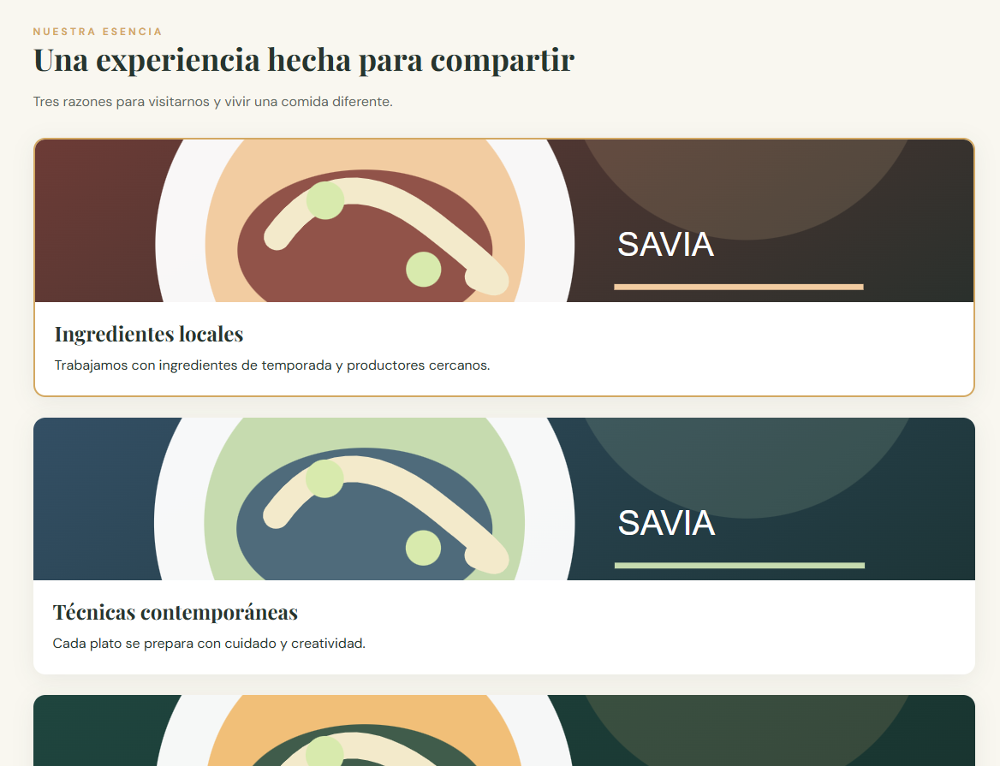
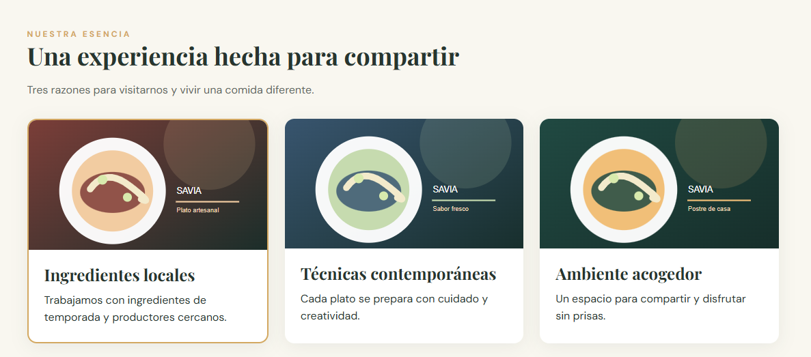
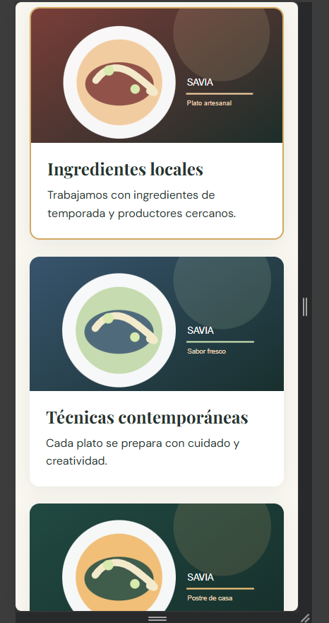
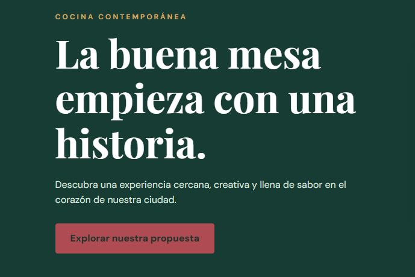
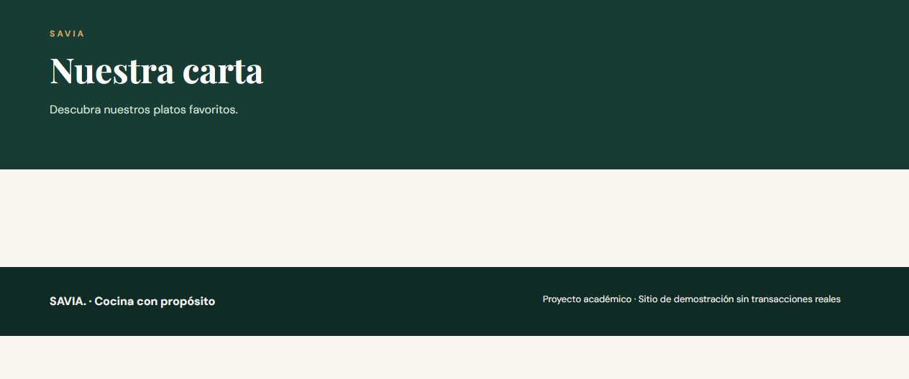
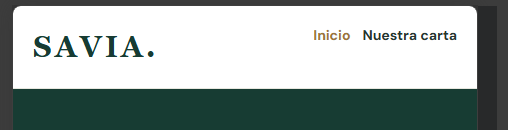
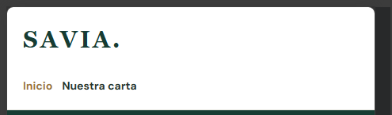

# SAVIA — examen N.º 1

Proyecto estático HTML + CSS. Abrir `index.html` en el navegador. No necesita dependencias.

El sitio incluye la página Inicio y las plantillas `pages/menu.html`, `pages/equipo.html` y `pages/eventos.html` con contenido central pendiente. Siga exclusivamente las especificaciones del examen para conocer el comportamiento esperado. No modifique el tema general ni sustituya el proyecto por otro.

## Diagnóstico de cinco incidencias

| N.º | Comportamiento observado                                        | Causa técnica y ubicación                                                                                         | Corrección realizada                                                                                                                                  | Prueba de verificación                                                          | Autor                    |
| --- | --------------------------------------------------------------- | ----------------------------------------------------------------------------------------------------------------- | ----------------------------------------------------------------------------------------------------------------------------------------------------- | ------------------------------------------------------------------------------- | ------------------------ |
| 1   | Las tarjetas no se acomodan en todo el espacio disponible       | Se encuentra dentro de .feature-layout que tiene un felx que las acomoda de forma de columna                      | Se cambió en el flex la dirección en fila y automáticamente en dispositivos de pantalla más pequeña se acomoda en columna según el espacio disponible |    | Sebastián Villegas Araya |
| 2   |                                                                 |                                                                                                                   |                                                                                                                                                       |                                                                                 |                          |
| 3   | El botón "Explorar nuestra propuesta" no funciona correctamente | El botón no está correctamente configurado por lo que al hacer click no lleva a ningún lado dentro del index.html | Dentro del href (propiedad del botón) se vinvula con la mágina "menu" y permite funcionar correctamente                                               |                               | Sebastián Villegas Araya |
| 4   |                                                                 |                                                                                                                   |                                                                                                                                                       |                                                                                 |                          |
| 5   | Al hacerse pequeño no quedaban debajo del logo de Savia         | En el media query no estaba bien colocado las medidas para permtir que el logo se colocara debajo del nav         | Se cambió el max-width a 375px                                                                                                                        |                                   | Sebastián VIllegas Araya |

## Responsables de las funcionalidades

| Estudiante | Página asignada | Rama | Commits principales |
| ---------- | --------------- | ---- | ------------------- |
|            |                 |      |                     |

## Evidencias Git

| Funcionalidad/corrección | PR hacia develop | Revisor | Resultado de merge / conflicto si ocurrió |
| ------------------------ | ---------------- | ------- | ----------------------------------------- |
|                          |                  |         |                                           |

## Verificación final

Registrar las pruebas de funcionamiento a 1280 px y 375 px, enlaces y páginas.
