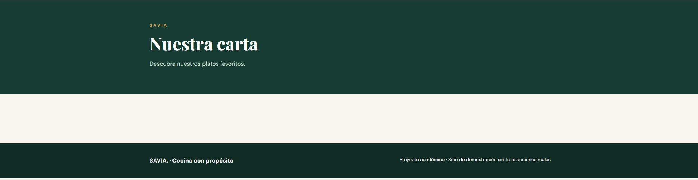
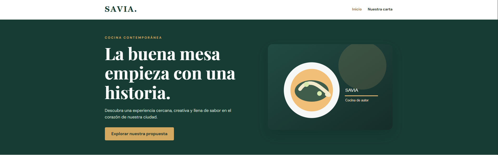

# SAVIA — examen N.º 1

Proyecto estático HTML + CSS. Abrir `index.html` en el navegador. No necesita dependencias.

El sitio incluye la página Inicio y las plantillas `pages/menu.html`, `pages/equipo.html` y `pages/eventos.html` con contenido central pendiente. Siga exclusivamente las especificaciones del examen para conocer el comportamiento esperado. No modifique el tema general ni sustituya el proyecto por otro.

## Diagnóstico de cinco incidencias

| N.º | Comportamiento observado              | Causa técnica y ubicación           | Corrección realizada                                                            | Prueba de verificación   | Autor                     |
| --- | ------------------------------------- | ----------------------------------- | ------------------------------------------------------------------------------- | ------------------------ | ------------------------- |
| 1   |                                       |                                     |                                                                                 |                          |                           |
| 2   | Al darle a nuestra carta va a eventos | En index se esta llamando a eventos | class="nav-contact" href="pages/menu.html"> Nuestra carta Ahora se llama a menu |  | Sebastián Marín Fernández |
| 3   |                                       |                                     |                                                                                 |                          |                           |
| 4   | El boton estaba colot rojo de fondo   | en styles css en hero-action        | simplemente se cambio el color a dorado y no se añadio nada mas                 |  | Sebastián Marín Fernández |
| 5   |                                       |                                     |                                                                                 |                          |                           |

## Responsables de las funcionalidades

| Estudiante | Página asignada | Rama | Commits principales |
| ---------- | --------------- | ---- | ------------------- |
|            |                 |      |                     |

## Evidencias Git

| Funcionalidad/corrección | PR hacia develop | Revisor | Resultado de merge / conflicto si ocurrió |
| ------------------------ | ---------------- | ------- | ----------------------------------------- |
|                          |                  |         |                                           |

## Verificación final

Registrar las pruebas de funcionamiento a 1280 px y 375 px, enlaces y páginas.
