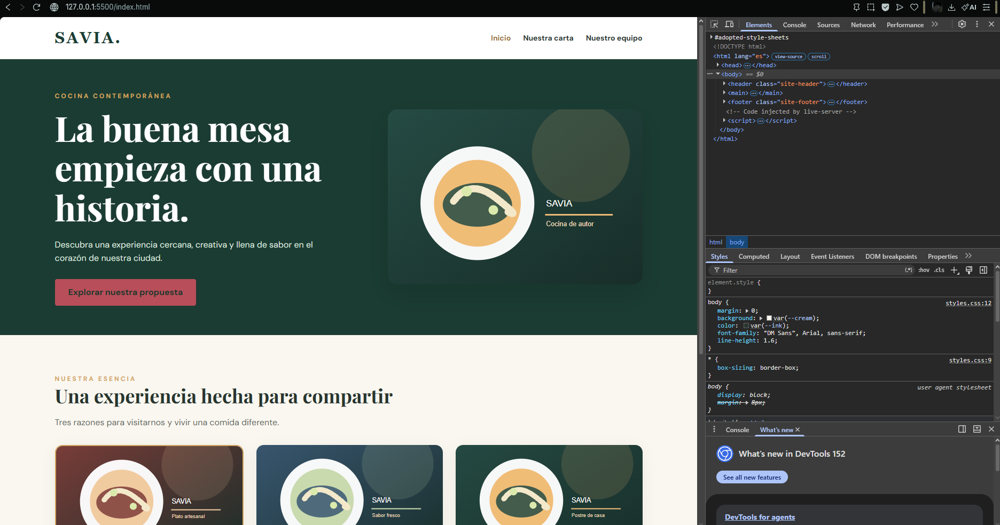
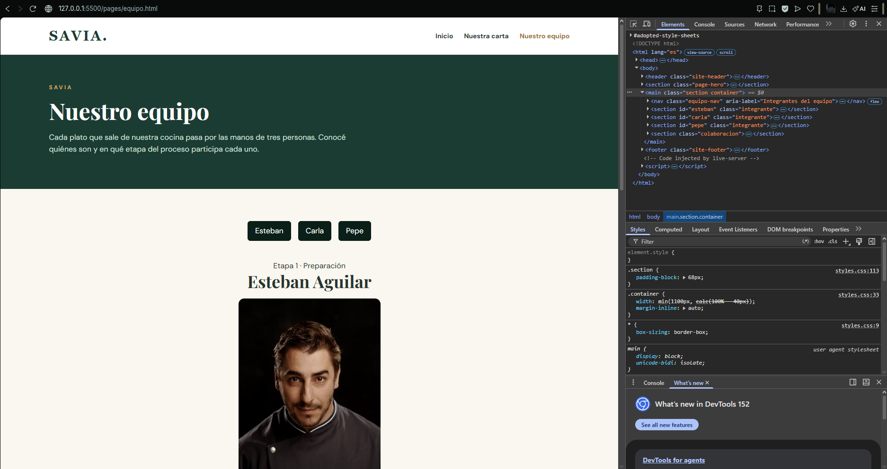
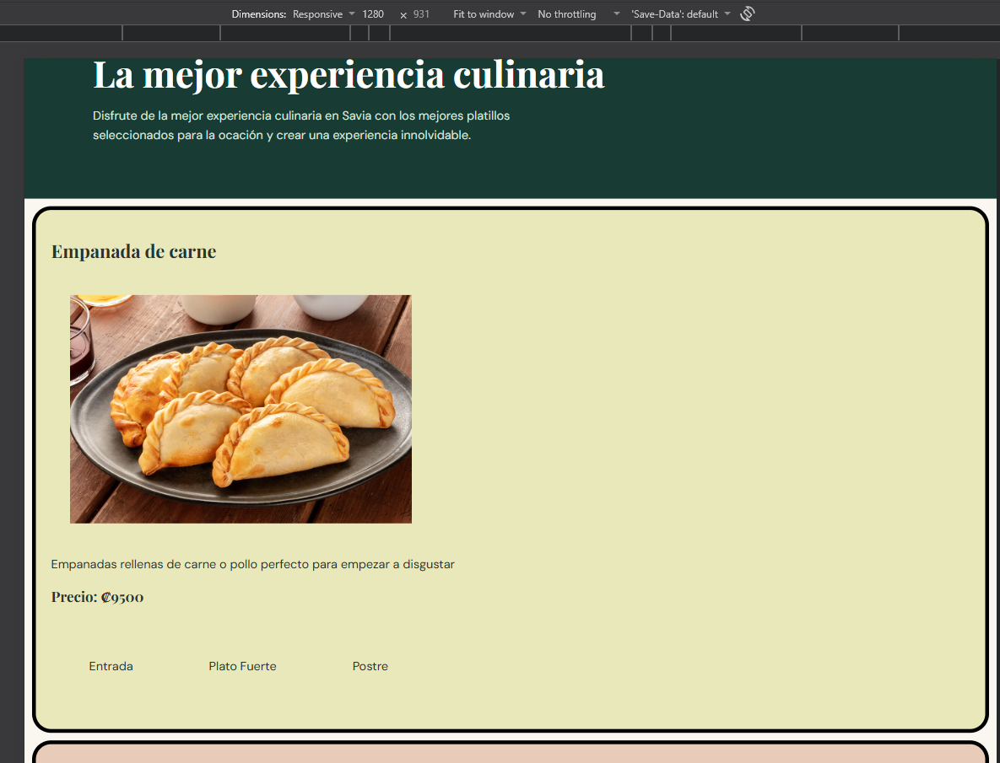
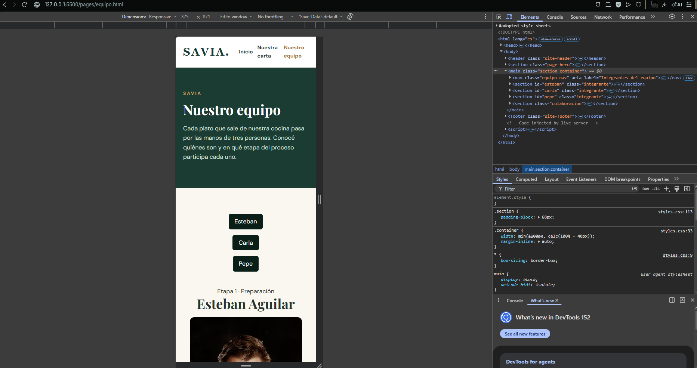
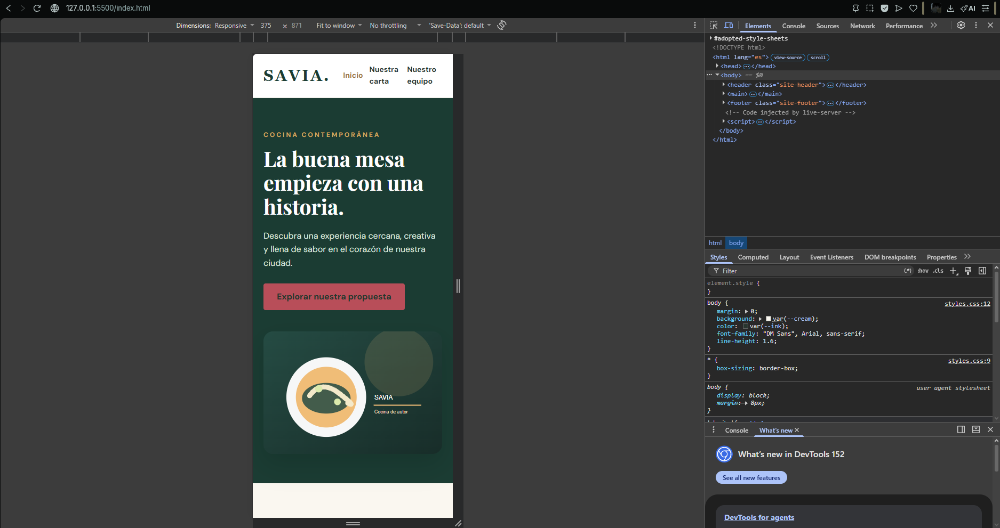
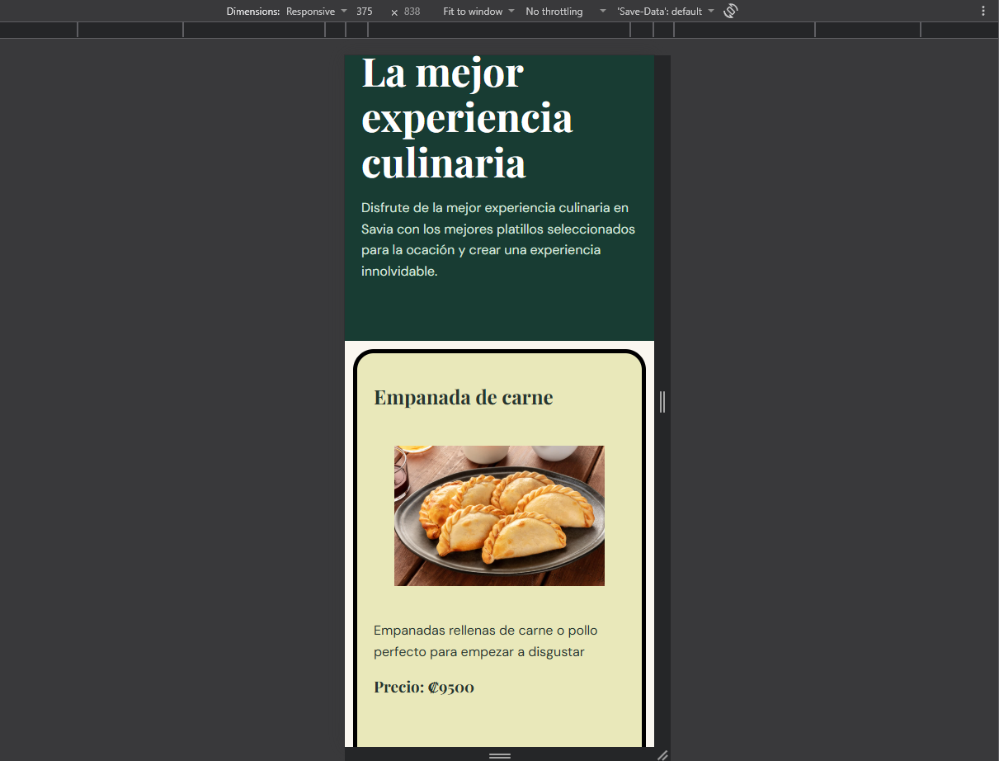

# SAVIA — examen N.º 1

Proyecto estático HTML + CSS. Abrir `index.html` en el navegador. No necesita dependencias.

El sitio incluye la página Inicio y las plantillas `pages/menu.html`, `pages/equipo.html` y `pages/eventos.html` con contenido central pendiente. Siga exclusivamente las especificaciones del examen para conocer el comportamiento esperado. No modifique el tema general ni sustituya el proyecto por otro.

## Diagnóstico de cinco incidencias

| N.º | Comportamiento observado                                        | Causa técnica y ubicación                                                                                         | Corrección realizada                                                                                                                                  | Prueba de verificación                                                          | Autor                    |
| --- | --------------------------------------------------------------- | ----------------------------------------------------------------------------------------------------------------- | ----------------------------------------------------------------------------------------------------------------------------------------------------- | ------------------------------------------------------------------------------- | ------------------------ |
| 1   | Las tarjetas no se acomodan en todo el espacio disponible       | Se encuentra dentro de .feature-layout que tiene un flex que las acomoda de forma de columna                      | Se cambió en el flex la dirección en fila y automáticamente en dispositivos de pantalla más pequeña se acomoda en columna según el espacio disponible |    | Sebastián Villegas Araya |
| 2   | Al darle a nuestra carta va a eventos | En index se esta llamando a eventos | class="nav-contact" href="pages/menu.html"> Nuestra carta Ahora se llama a menu |  | Sebastián Marín Fernández |                      |
| 3   | El botón "Explorar nuestra propuesta" no funciona correctamente | El botón no está correctamente configurado por lo que al hacer click no lleva a ningún lado dentro del index.html | Dentro del href (propiedad del botón) se vincula con la página "menu" y permite funcionar correctamente                                               |                               | Sebastián Villegas Araya |
| 4   | El boton estaba color rojo de fondo   | en styles css en hero-action        | simplemente se cambio el color a dorado y no se añadio nada mas                 |  | Sebastián Marín Fernández |                      |
| 5   | Al hacerse pequeño no quedaban debajo del logo de Savia         | En el media query no estaba bien colocado las medidas para permitir que el logo se colocara debajo del nav         | Se cambió el max-width a 375px                                                                                                                        |                                   | Sebastián Villegas Araya |

## Responsables de las funcionalidades

| Estudiante | Página asignada | Rama | Commits principales |
| ---------- | --------------- | ---- | ------------------- |
| Sebastián Marín Fernández           | Nuestro equipo                | Sebas763     |  `dbdb86b` Avance de parte individual 2, `50889b5` Feature 2 — Equipo: detrás de cada plato, `2c53458` use flex |
| Sebastián Villegas Araya  |  Carta interactiva        | Sebas-Villegas    | `cab5bf5` incorporación feature 1, `efe6e0a` Retoques finales del feature 1 ||                  |

## Evidencias Git

| Funcionalidad/corrección | PR hacia develop | Revisor | Resultado de merge / conflicto si ocurrió |
| ------------------------ | ---------------- | ------- | ----------------------------------------- |
| Corrección de las 5 incidencias | [#1](https://github.com/Sebas763/Examen-1-Sebasti-n-Mar-n-Sebasti-n-Villegas_DEV-IV/pull/1) | Sebastián Villegas Araya (revisión posterior al merge) | Merge automático, sin conflictos |
| Feature 2: Nuestro equipo | [#2](https://github.com/Sebas763/Examen-1-Sebasti-n-Mar-n-Sebasti-n-Villegas_DEV-IV/pull/2) | Sebastián Villegas Araya (revisión posterior al merge) | Merge automático, sin conflictos |
| README inicial | [#3](https://github.com/Sebas763/Examen-1-Sebasti-n-Mar-n-Sebasti-n-Villegas_DEV-IV/pull/3) | Sebastián Villegas Araya | Merge automático, sin conflictos |
| Feature 1: Carta interactiva | [#4](https://github.com/Sebas763/Examen-1-Sebasti-n-Mar-n-Sebasti-n-Villegas_DEV-IV/pull/4) | Sebastián Marín Fernández | Antes del PR se sincronizó la rama con develop (`d016900`): merge automático, sin conflictos |
| Integración develop → main | [#5](https://github.com/Sebas763/Examen-1-Sebasti-n-Mar-n-Sebasti-n-Villegas_DEV-IV/pull/5) | Sebastián Villegas Araya | Merge automático, sin conflictos |
| README final | [#6](https://github.com/Sebas763/Examen-1-Sebasti-n-Mar-n-Sebasti-n-Villegas_DEV-IV/pull/6) | Sebastián Villegas Araya | Merge automático, sin conflictos |

## Verificación final

1280 px (escritorio): Inicio, Nuestra carta y Nuestro equipo se muestran correctamente, sin elementos desbordados.

375 px (móvil): el contenido se reorganiza en una columna y la navegación se adapta al ancho de pantalla.

el menú principal funciona desde todas las páginas; los botones de Nuestro equipo desplazan a cada integrante igual en nuestra carta.

todas las imágenes cargan correctamente y están guardadas localmente en el proyecto.

herramientas de desarrollador del navegador (Inspeccionar).